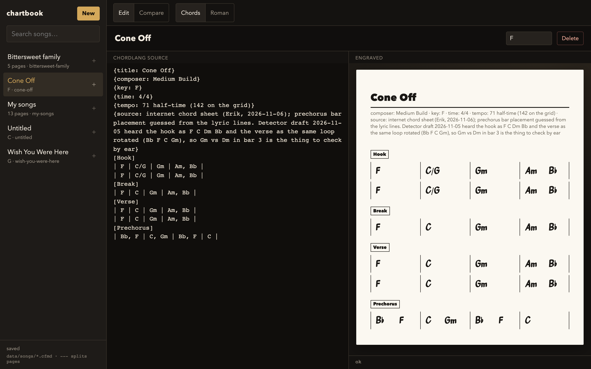
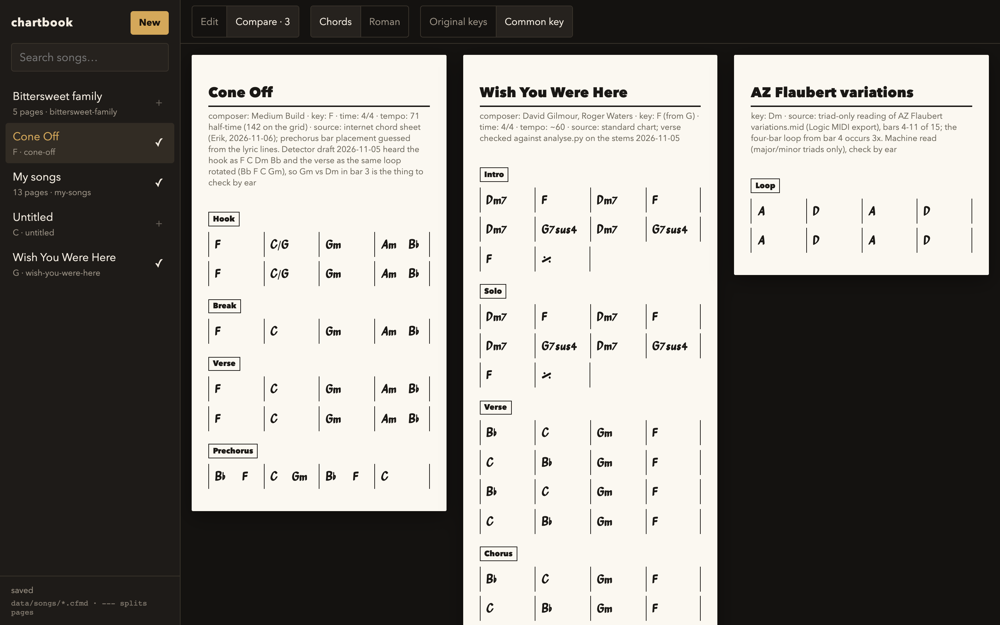

# chartbook

Local song catalog + live **chordlang** chart editor. It combines the monorepo
packages: `@chordlang/parser` for the chart grammar, `@chordlang/chord` for
chord spelling (transposition, roman numerals), and ChordFont for engraving.




Charts are plain `.cfmd` files on disk (`data/songs/`). Edit in the browser with
a ChordFont-engraved preview; autosave writes back to the file.

## Run

From the repo root:

```bash
pnpm install
pnpm chartbook
```

Opens http://127.0.0.1:5178. Vite aliases `@chordlang/*` to package source, so
edits to the packages hot-reload with no rebuild.

## Views

- **Edit**: chordlang source on the left, engraved page on the right.
- **Compare**: pin songs with **+** in the list; pinned charts render side by side,
  each in its own original key. The set is remembered per browser.
- **Original keys / Common key** (Compare only): move every pinned chart to the first
  pinned chart's key so the progressions line up. Spelled transposition (`src/transpose.ts`):
  letters shift diatonically, so Bm → Em turns F# into C#, not Db; double accidentals are
  respelled. A minor chart compared against a major key lands in the relative minor and
  vice versa. The page meta shows `key: Em (from Bm)` when a chart moved.
- **Chords / Roman**: notation toggle for both views. Roman numerals come from the
  `{key: …}` directive (uppercase major, lowercase minor, `ø` `°` `+` `△7`, slash bass as
  a scale degree). ChordFont has no roman style yet, so numerals are set in the UI sans.

## Shortcuts

- **⌘/Ctrl+S** — save now
- Autosave ~450ms after edits
- **New** / **Delete** in the sidebar and editor bar

## Format

Same chordlang chart dialect as the playground (`apps/playground`):

```
{title: Song Name}
{key: G}
| G | Em | C | D |
| G, D | Em | C | D |
```

Comma = beat/cell split within a bar. `%` = repeat previous bar.

### Books (several charts in one file)

A line of three or more dashes splits a `.cfmd` into pages. Each page is a complete
chart with its own `{title}`/`{key}`; the editor renders them as a stack of pages, and
Compare shows every page of a pinned book. An optional `{book: Name}` directive names the
file in the sidebar (and is hidden from the page meta); the title input edits it, and the
key input is hidden since each page has its own key.

```
{book: Bittersweet family}
{title: Wish You Were Here}
{key: G}
| C | D | Am | G |
---
{title: Mr. Jones}
{key: C}
| Am | F | Dm | G |
```

`data/songs/bittersweet-family.cfmd` is the first one: the 8 or so bars that carry each
song's progression, not whole songs. The bundled songs are chord names only.

## Design

Hierarchy ranking (see `src/main.ts` header): the engraved chart is P1 in both views, the
source or the page title is P2, and toolbar, meta lines and section tags are P3. The accent
colour is reserved for the one primary action (New) and the active song.

Tokens live in `src/styles.css` `:root`; `public/chart.css` is the chordlang layout.

```
Type scale:     0.7 / 0.75 / 0.875 / 1 / 1.25 / 1.5 / 1.65 rem
Spacing scale:  0.25 / 0.5 / 0.75 / 1 / 1.5 / 2 rem
Text colors:    primary=--ink  muted=--muted (5.4:1 on --panel)  paper=--paper-ink on --paper
Brand primary:  --accent (#d4a85a), P1 actions and the active song only
Elevation:      flat panels; the paper .page shadow is the one raised layer
Primitives:     .btn (.primary .ghost .danger), .seg/.seg-btn, .song-row/.cmp-toggle, .page
Tap targets:    2.75rem (44px) minimum on buttons and list rows
```
